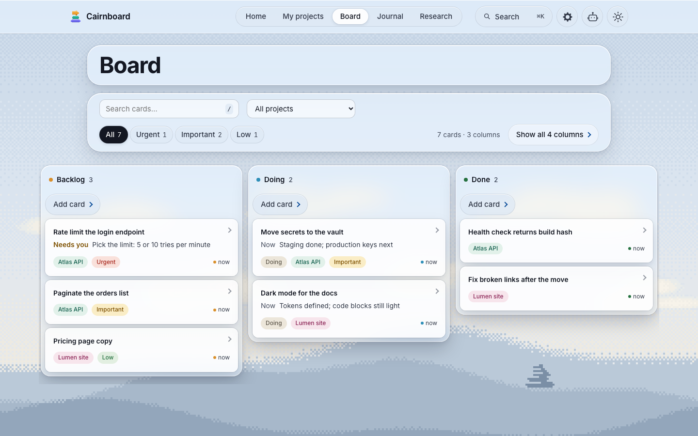
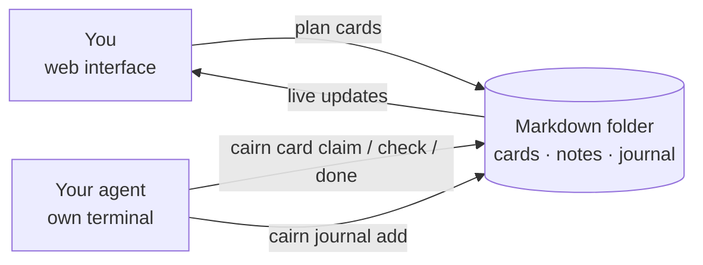
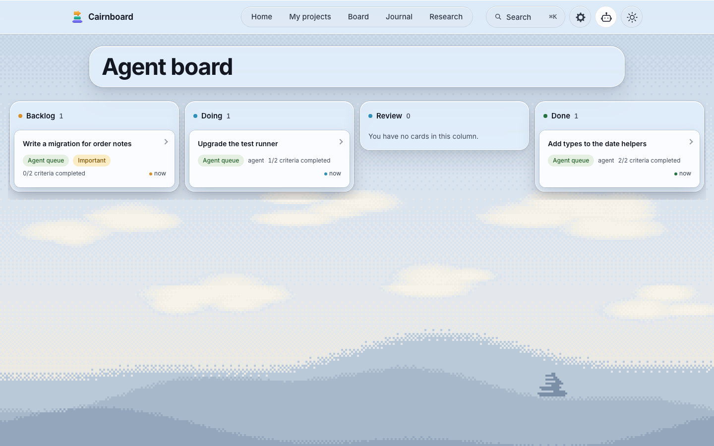
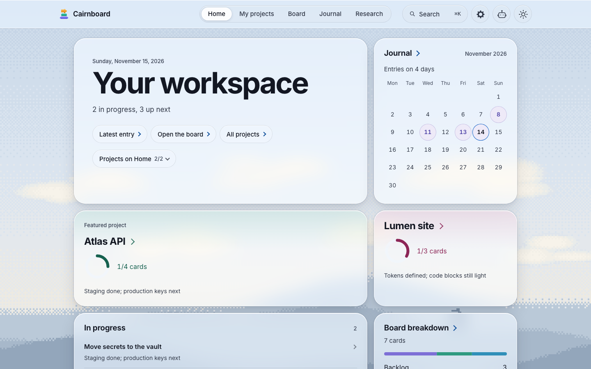
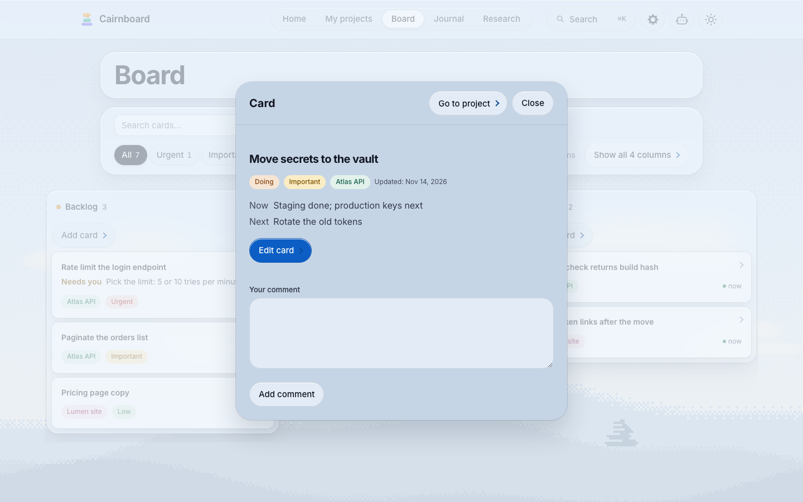
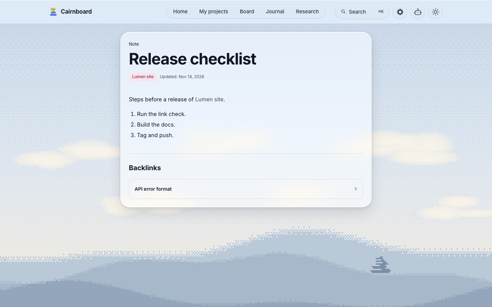
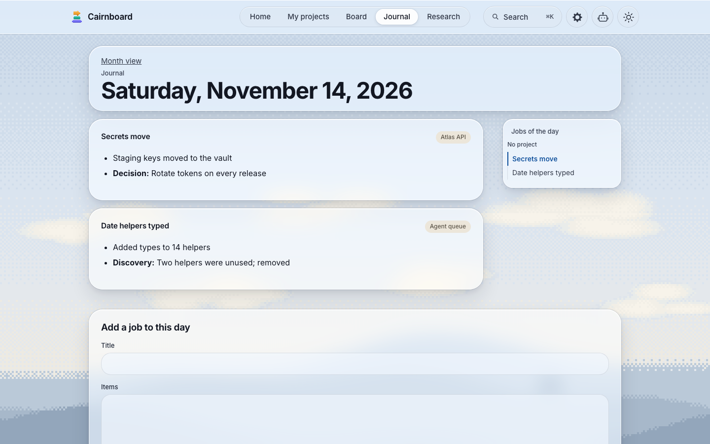

# Cairnboard

**A local project board, wiki and journal that your coding agents can use too.**

[Quick start](#quick-start) · [Documentation](#documentation) · [Türkçe](README.tr.md)

[](https://github.com/Zenginby/cairnboard/actions/workflows/ci.yml)
[](LICENSE)


<picture>
  <source media="(prefers-color-scheme: dark)" srcset="docs/images/board-dark.png">
  
</picture>

Cairnboard is for developers who work with coding agents (Claude Code, Codex, Gemini CLI, Cursor). It keeps many
projects in one folder of plain Markdown files that you can also open in Obsidian, and gives your agent a
command-line tool so it can pick up a card, report progress and log what it did. Cairnboard never starts agents
itself; your agent runs in its own terminal and uses the board as shared state.

**Status:** early (0.1.0), under active development. The board, wiki, journal, web interface and CLI work; file formats
may still change. The interface speaks the data folder's language, English or Turkish
(`init --language en|tr`).

## Why Cairnboard

- **Plain files.** Cards, notes and journal days are Markdown with frontmatter. Read them in any editor or Obsidian,
  back them up with Git.
- **Built for agents.** A versioned `--json` envelope with revisions, leases and exit codes, so an agent can claim a
  card, tick its acceptance checks and close it without stepping on your edits.
- **One place for many projects.** A board, a wiki with backlinks, a journal and a separate agent board.
- **Local only.** The server listens on loopback and every page needs a sign-in cookie; your data stays on your machine.

## How it works



## Quick start

Requires Node.js ≥ 22.23.4.

```sh
git clone https://github.com/Zenginby/cairnboard.git
cd cairnboard
npm ci
npm run build:cli
node dist/cairn.mjs init ~/Cairn --language en --actor owner
npm start
```

`init` creates the data folder and remembers it. `npm start` builds the web interface, starts it on your machine
only and opens your browser with a one-time sign-in link. Later, `node dist/cairn.mjs open` reopens a running
instance (or `cairn open` after `npm link`).

Already have an Obsidian vault? `node dist/cairn.mjs init --detect "./vault" --dry-run --actor owner`
previews how its folders would map,
without touching your notes. See [CLI](docs/cli.md).

## Use it with your agent

Install the Cairnboard skill for your agents (run it yourself; it asks for confirmation):

```sh
node dist/cairn.mjs agent install
```

The skill teaches the agent the workflow (it calls the CLI by its full path):

```sh
cairn card list --unassigned --column-role todo --compact --json
cairn card claim <card> --actor agent --json
cairn card check <card> 1 --actor agent --json
cairn card done <card> --if-revision <revision> --actor agent --json
cairn journal add --label acme --title "What I did" --item "…" --actor agent --json
```

Name a project in `.cairn/config.json` as `"agents": { "project": "<project-id>" }` and its cards move to their own
agent board, so agent work stays apart from yours.

<picture>
  <source media="(prefers-color-scheme: dark)" srcset="docs/images/agents-dark.png">
  
</picture>

## Screenshots

| | |
| --- | --- |
| <picture><source media="(prefers-color-scheme: dark)" srcset="docs/images/home-dark.png"></picture> | <picture><source media="(prefers-color-scheme: dark)" srcset="docs/images/card-dark.png"></picture> |
| Home | Card |
| <picture><source media="(prefers-color-scheme: dark)" srcset="docs/images/note-dark.png"></picture> | <picture><source media="(prefers-color-scheme: dark)" srcset="docs/images/journal-dark.png"></picture> |
| Wiki note | Journal |

Screenshots use fictional data and are generated with `npm run screenshots`.

## Security model

The web interface listens only on `127.0.0.1` and `::1`, at a private `*.cairnboard.localhost` address derived from
your key. Every page needs a sign-in cookie, and the key stays in your user state folder, never in the data folder.
Commands only the owner should run (removing a project, taking over a claim, changing settings, installing the
agent skill) ask for confirmation and refuse to run inside a known coding-agent shell. Details:
[Web interface](docs/web-interface.md) and [SECURITY.md](SECURITY.md).

## Documentation

- [Web interface](docs/web-interface.md): address and sign-in, read API, agent board, optional tools list
- [CLI](docs/cli.md): install, data folder, agent workflow, JSON output and exit codes
- [Wiki](docs/wiki.md): context packs, ingesting sources, lint and checks, mentions, Claude Code hook
- [Settings](docs/settings.md): change trail, diffs, live updates, mentions
- [Changelog](CHANGELOG.md) · [Contributing](CONTRIBUTING.md) · [Design](DESIGN.md)

## License

[MIT](LICENSE)
