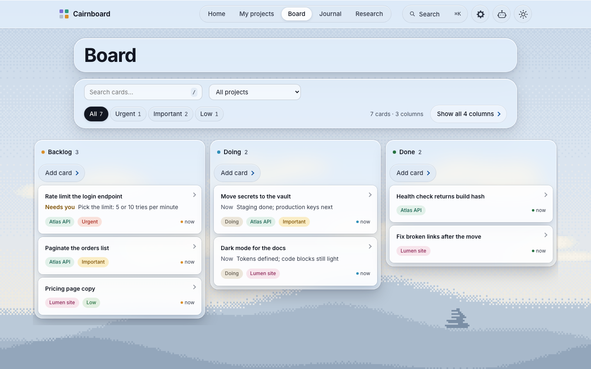
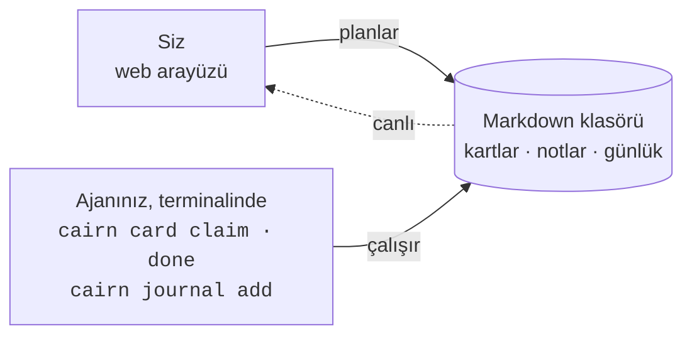
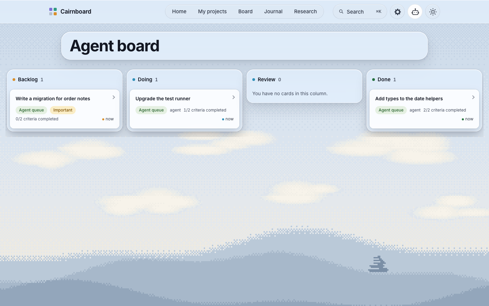
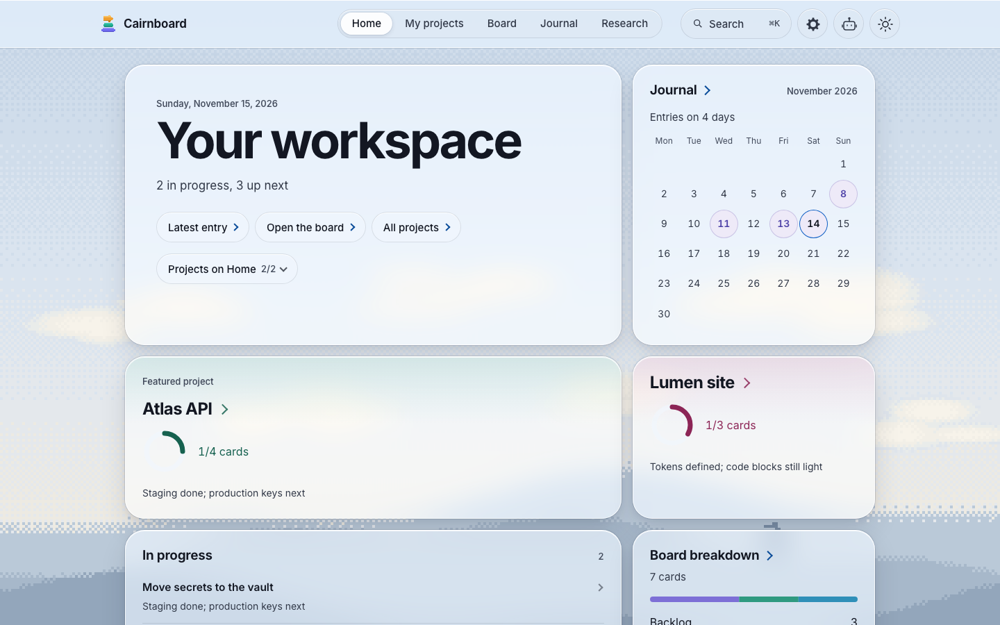
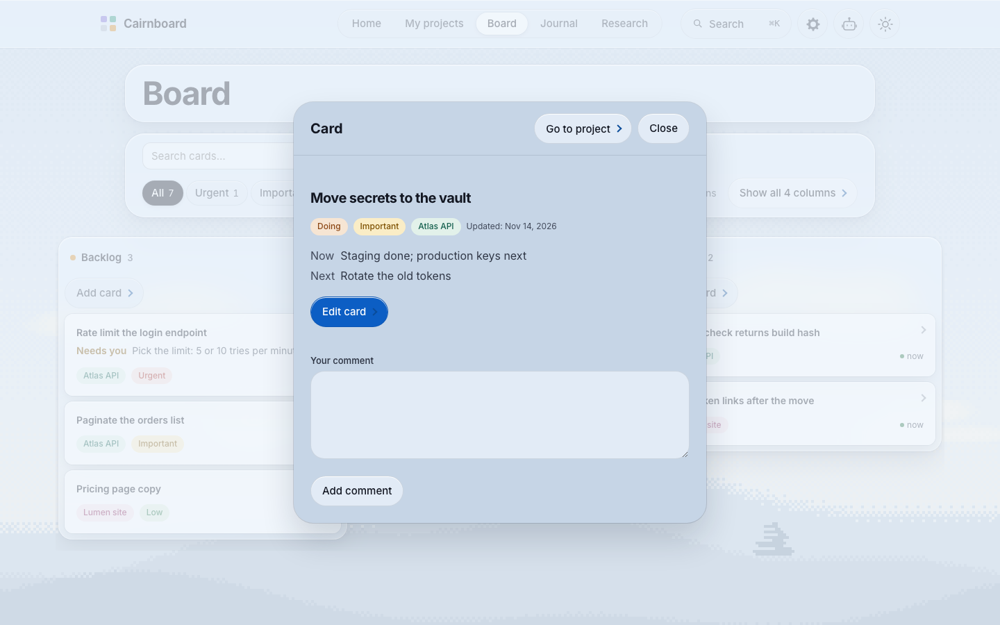
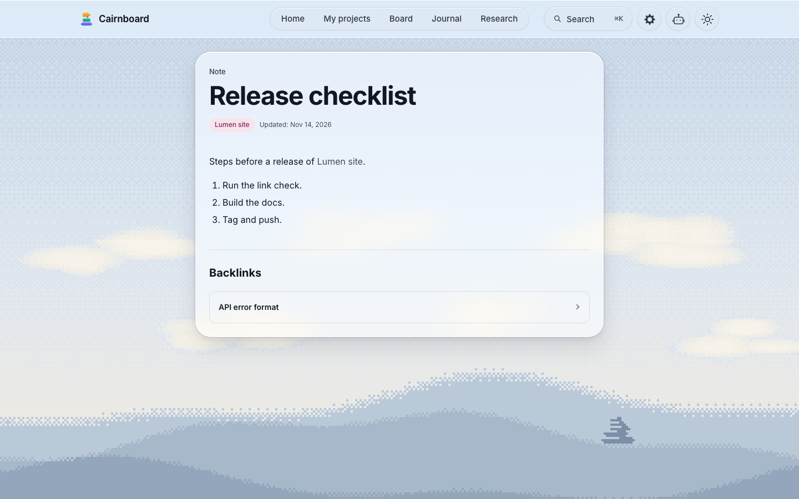
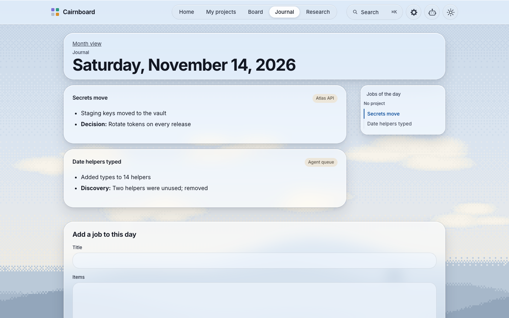

# Cairnboard

**Kodlama ajanlarınızın da kullanabildiği yerel proje panosu, wiki ve günlük.**

[Hızlı başlangıç](#hızlı-başlangıç) · [Belgeler](#belgeler) · [English](README.md)

[](https://github.com/Zenginby/cairnboard/actions/workflows/ci.yml)
[](LICENSE)


<picture>
  <source media="(prefers-color-scheme: dark)" srcset="docs/images/board-dark.png">
  
</picture>

Cairnboard, kodlama ajanlarıyla (Claude Code, Codex, Gemini CLI, Cursor) çalışan geliştiriciler için yerel bir
proje panosu, not ve günlük uygulamasıdır. Birden çok projeyi, Obsidian'da da açılabilen düz Markdown
dosyalarından oluşan tek bir klasörde tutar; ajanınıza bir komut satırı aracı verir, ajan bir kartı alır,
ilerlemesini yazar ve yaptığını günlüğe kaydeder. Cairnboard ajan başlatmaz; ajanınız kendi terminalinde
çalışır ve panoyu ortak durum olarak kullanır.

**Durum:** erken sürüm (0.3.0), geliştirme sürüyor. Pano, wiki, günlük, web arayüzü ve komut satırı aracı
çalışıyor; dosya biçimleri değişebilir. Arayüz, veri klasörünün diline göre Türkçe ya da İngilizce açılır
(`init --language tr|en`). Görseller İngilizce örnek veriyle çekildi.

## Neden Cairnboard

- **Düz dosyalar.** Kartlar, notlar ve günlük günleri ön bilgili (frontmatter) Markdown dosyalarıdır. Her
  düzenleyicide ya da Obsidian'da açılır, Git ile yedeklenir.
- **Ajanlar için yapıldı.** Sürüm numarası, kira süresi ve çıkış kodlarıyla sürümlü bir `--json` çıktısı; ajan
  kartı alır, kabul ölçütlerini işaretler ve sizin düzenlemelerinizi ezmeden kapatır.
- **Birçok proje tek yerde.** Pano, geri bağlantılı wiki, günlük ve ayrı bir ajan panosu.
- **Yalnız yerel.** Sunucu yalnız bu bilgisayardan erişilir, her sayfa oturum çerezi ister; verileriniz
  bilgisayarınızda kalır.

## Nasıl çalışır



## Hızlı başlangıç

Node.js ≥ 22.23.4 gerekir.

```sh
npx cairnboard
```

Cairnboard ilk çalıştırmada `~/Cairn` klasörünü oluşturup kaydeder, yerel sunucuyu başlatır ve tarayıcınızı
tek kullanımlık bir giriş bağlantısıyla açar.

Günlük kullanım ve ajan kurulumu için genel kurulum yapın:

```sh
npm i -g cairnboard
cairnboard
```

Çalışan arayüzü `cairn open` ile yeniden açın. Veri klasörünü seçmek için `cairn start --data <yol>` kullanın.
Var olan bir Obsidian kasanız mı var? `cairn init --detect "./kasa" --dry-run --actor owner` komutuyla
klasör eşlemelerini önizleyin. Bkz. [CLI](docs/tr/cli.md).

## Ajanınızla kullanın

Cairnboard yeteneğini ajanlarınıza kurun (kendiniz çalıştırın; onay ister):

```sh
cairn agent install
```

Yetenek ajana iş akışını öğretir (komut satırı aracını tam yoluyla çağırır):

```sh
cairn card list --unassigned --column-role todo --compact --json
cairn card claim <kart> --actor agent --json
cairn card check <kart> 1 --actor agent --json
cairn card done <kart> --if-revision <sürüm> --actor agent --json
cairn journal add --label acme --title "Yaptığım iş" --item "…" --actor agent --json
```

`.cairn/config.json` içinde bir projeyi `"agents": { "project": "<proje-id>" }` olarak adlandırırsanız kartları
ayrı bir ajan panosuna taşınır; ajan işi sizinkinden ayrı durur.

<picture>
  <source media="(prefers-color-scheme: dark)" srcset="docs/images/agents-dark.png">
  
</picture>

## Ekran görüntüleri

| | |
| --- | --- |
| <picture><source media="(prefers-color-scheme: dark)" srcset="docs/images/home-dark.png"></picture> | <picture><source media="(prefers-color-scheme: dark)" srcset="docs/images/card-dark.png"></picture> |
| Ana sayfa | Kart |
| <picture><source media="(prefers-color-scheme: dark)" srcset="docs/images/note-dark.png"></picture> | <picture><source media="(prefers-color-scheme: dark)" srcset="docs/images/journal-dark.png"></picture> |
| Wiki notu | Günlük |

Görseller kurgusal veriyle `npm run screenshots` komutuyla üretilir.

## Güvenlik modeli

Web arayüzü yalnız `127.0.0.1` ve `::1` üzerinde, anahtarınızdan türetilen özel bir `*.cairnboard.localhost`
adresinde dinler. Her sayfa oturum çerezi ister; anahtar veri klasöründe değil, kullanıcı durum klasörünüzde
durur. Yalnız sahibin çalıştırması gereken komutlar (proje silme, başkasının kartını devralma, ayar değiştirme,
ajan yeteneğini kurma) onay ister ve bilinen bir kodlama ajanı kabuğunda çalışmayı reddeder. Ayrıntı:
[Web arayüzü](docs/tr/web-arayuzu.md) ve [SECURITY.md](SECURITY.md).

## Belgeler

- [Web arayüzü](docs/tr/web-arayuzu.md): adres ve giriş, okuma API'si, ajan panosu, isteğe bağlı araç listesi
- [CLI](docs/tr/cli.md): kurulum, veri klasörü, ajan iş akışı, JSON çıktısı ve çıkış kodları
- [Wiki](docs/tr/wiki.md): bağlam paketi, kaynak alma, denetim, anmalar, Claude Code kancası
- [Ayarlar](docs/tr/ayarlar.md): değişiklik izi, farklar, canlı güncelleme, anmalar
- [Değişiklik günlüğü](CHANGELOG.md) · [Katkı](CONTRIBUTING.md) · [Tasarım](DESIGN.md)

## Lisans

[MIT](LICENSE)
